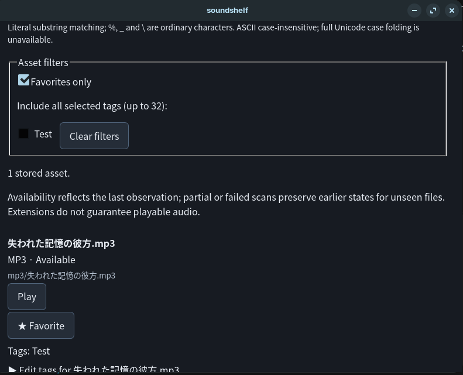
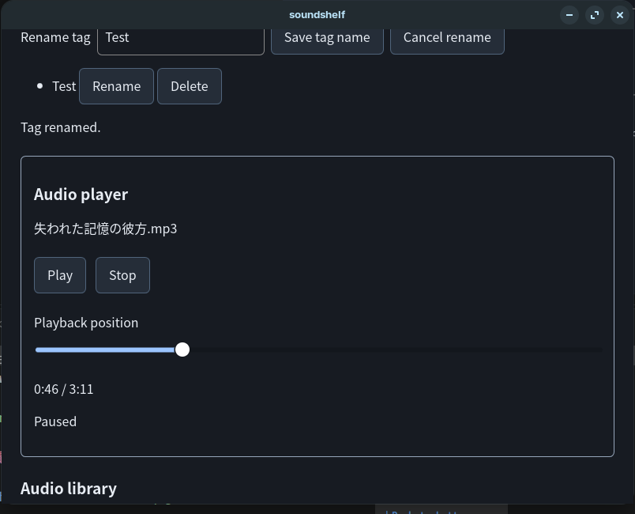

# SoundShelf

SoundShelf is a local-first Linux desktop application for organizing and previewing audio assets. It indexes selected directories, searches filenames, paths and tags, and stores favorites and annotations in SQLite while keeping original audio files unchanged.

**MVP status:** Milestones 1–4 are implemented. The user reports that the fixed Debian build passed playback regressions (6/6), audible WAV/MP3/OGG output, operation without Vite, scanning/search/tags/favorites, persistence, reauthorization and data-preserving reinstallation. These are user-reported manual results, not independently executed by Codex. Automated results and the remaining distribution decisions are recorded in the [release checklist](docs/RELEASE_CHECKLIST.md). Historical milestone evidence remains in [Milestone 4](docs/MILESTONE_4.md).

## Features

- **Directory selection:** authorize local audio roots through a native GTK directory picker; browse saved libraries after restarting.
- **Read-only discovery:** recursively scan WAV, MP3 and OGG candidates with case-insensitive extensions, progress, partial-scan warnings and availability states.
- **Search and pagination:** search filenames, relative paths and tag names with deterministic ordering and 50 results per UI page. `%`, `_` and backslash are literal search characters.
- **SQLite persistence:** retain stable asset IDs, tags and favorites across restarts and rescans, including when files become missing or inaccessible.
- **Audio preview:** use one player with play, pause, resume, stop, seeking and recoverable errors. Codec support depends on the installed WebKitGTK/GStreamer runtime.
- **Tags and favorites:** create, rename, delete, assign and remove tags; favorite or unfavorite assets without changing their audio files.
- **Combined filters:** combine search with favorites-only and selected tags. Multiple selected tags require all of them to be present.
- **Accessible controls:** native form controls, labeled actions, visible focus, status announcements and explicit loading, empty and error states. The user reports successful keyboard operation and light/dark theme testing; screen-reader results are not recorded.

## Supported environment

SoundShelf currently targets **Linux only**, with kernel support for `openat2`. The prepared Debian package is **amd64/x86_64** and requires **glibc 2.39 or later**. Secure file resolution has no compatibility fallback. Windows, macOS, other architectures and older glibc systems are not supported by this package.

The recorded development/test environment is Zorin OS 18.1, GTK 3.24.41 and WebKitGTK 2.52.6. This is a tested environment, not a distribution compatibility matrix. Runtime versions for the user's latest GUI test report were not supplied.

Building from source requires:

- Rust 1.90 or later (the highest declared minimum among locked Linux build dependencies), Cargo, rustfmt and Clippy. This checkout was tested with Rust 1.99.1; Rust 1.90 itself was not tested.
- Node.js 24 or later and npm. Frontend tests use Node's built-in TypeScript stripping and test runner.
- The [Tauri 2 Linux prerequisites](https://v2.tauri.app/start/prerequisites/), including a native build toolchain and GTK/WebKitGTK development libraries. The application also uses libsoup 3 for local audio streaming.
- A working graphical desktop session and GStreamer audio plugins supporting the files being previewed.

SQLite is bundled through `rusqlite`; no separate database server is needed. Initial dependency installation may require internet access. The application itself requires no external service or account.

## Installation and development

The v0.1.0 candidate is prepared locally; it is not an official published release and no download URL is asserted. The user has accepted the playback fix in the installed Debian candidate; see the [investigation](docs/PLAYBACK_DURATION_INVESTIGATION.md). AppImage packaging remains unavailable. The user approved the original folder/waveform icon and MIT licensing of their own screenshot image rights. Final packaging still awaits an installation/launcher smoke check and publication approval; see the [license review](docs/THIRD_PARTY_LICENSE_REVIEW.md), [candidate notes](docs/releases/v0.1.0.md) and [release checklist](docs/RELEASE_CHECKLIST.md).

For a reviewed Debian artifact, verify its `SHA256SUMS`, then install or replace the same-version candidate using your graphical package installer or:

```sh
sha256sum -c SHA256SUMS
pkexec apt install --reinstall "$(realpath soundshelf_0.1.0_amd64.deb)"
soundshelf
```

Close SoundShelf before replacement. Use the latest artifact directory and checksum in the release notes; older packages remain preserved for evidence. To uninstall through an authenticated package-manager session, run `pkexec apt remove soundshelf`. The package has no cleanup script that removes application data. Your SQLite metadata remains in your application-data directory; do not delete it when testing reinstall behavior. These commands are instructions, not a claim that Codex installed or removed a package.

From a local checkout of this repository, install the locked frontend dependencies:

```sh
npm ci
```

Start the desktop application in development mode:

```sh
npm run tauri -- dev
```

Tauri starts Vite on port 1420 and compiles the Rust application. Cargo resolves Rust dependencies on the first build. `npm run dev` starts only the frontend server; native directory selection, database access and playback preparation require the Tauri application.

### Build a local executable

```sh
npm run tauri -- build --debug --no-bundle -- --offline
./src-tauri/target/debug/soundshelf
```

This builds a debug executable with bundled frontend assets, without creating installers. Vite does not need to be running when using that executable. Cargo's `--offline` flag requires dependencies to be cached; omit the final `-- --offline` on an initial build that needs to download them. These instructions describe building from source and do not imply that downloadable releases or installers are available.

The commands above match the package scripts and Tauri configuration. Current executed tests/builds and user-reported installed-package acceptance are recorded separately in the release checklist; the milestone reports retain their historical results.

## Using SoundShelf

1. Choose **Select audio directory**, then **Start scan**. **Refresh scan** repeats discovery; canceling the picker preserves the current view.
2. Search stored filenames, relative paths or tags, then browse with **Previous** and **Next**. Search uses literal substring matching and is ASCII case-insensitive; full Unicode case folding is unavailable.
3. Choose **Play** beside an asset to use the single player. An extension identifies a candidate and does not guarantee decodable audio.
4. Use **Tags** to create or rename tags, **Edit tags** beside an asset to assign/remove them, and **Favorite** to toggle its favorite state. Combine **Favorites only** with tag filters as needed.
5. After restarting, browse and annotate saved results while libraries are inactive. Select their directories again through the native picker to authorize scanning and playback.

Tag names are trimmed, limited to 1–64 Unicode scalar values, and deduplicated using Unicode lowercase mapping without Unicode normalization. Each asset supports up to 32 distinct tags. Tags are global to the index: deleting a tag removes its assignments across all libraries.

The index is `soundshelf.sqlite3` in Tauri's application-data directory, normally `$XDG_DATA_HOME/dev.soundshelf.app` on Linux, or `$HOME/.local/share/dev.soundshelf.app` when XDG_DATA_HOME is unset. No database or sidecars are created inside selected audio directories.

## Stack and architecture

| Layer | Technology and responsibility |
| --- | --- |
| Native backend | Rust: directory authorization, filesystem validation, worker scans, SQLite operations and authorized playback reads |
| Desktop runtime | Tauri 2: native window and typed command bridge; GTK directory picker and WebKitGTK media runtime |
| Frontend | React and TypeScript: presentation, interaction, query/filter state and one HTML audio player |
| Frontend build | Vite and TypeScript |
| Local storage | SQLite through `rusqlite`: versioned migrations, parameterized SQL and transactional updates |

The main flow is native picker → session authorization → background scan → SQLite index → paginated typed IPC query → React results → authorized playback. Annotation commands update only SQLite. Filesystem and database work runs on blocking workers rather than the UI thread.

Rust request/response types in `src-tauri/src/contracts.rs` are matched by TypeScript interfaces, runtime response parsers and shared serialization fixtures in `src/lib/`. React uses opaque library and asset IDs; display paths do not grant filesystem access. Query and mutation generations prevent obsolete asynchronous responses from replacing newer UI state.

Key source locations:

- `src-tauri/src/{library,secure_fs,scan}.rs`: authorization and discovery.
- `src-tauri/src/db.rs` and `src-tauri/migrations/`: indexing, annotations and schema.
- `src-tauri/src/{playback,playback_protocol}.rs`: validated audio reads and the loopback streaming adapter.
- `src/App.tsx`, `src/components/` and `src/lib/`: UI, player, controllers and typed IPC.

## Privacy and filesystem security

SoundShelf has no cloud services, accounts, telemetry or external API keys. Library paths and annotations stay in the local index. It does not intentionally modify audio bytes, embedded tags, filenames, modes or timestamps, and it creates no media sidecars. Normal OS reads may update access times.

Only the trusted native picker grants session access. Stored database paths and frontend arguments cannot authorize a directory. Restart clears authorization; inactive saved libraries remain searchable and editable without filesystem access.

Scanning and playback resolve resources relative to retained authorized directory handles using Linux `openat2`, with beneath-root, no-symlink and no-cross-mount containment. Traversal and symlink replacements are rejected; observed root replacement revokes access. Tauri commands are scoped to the main window, with no general frontend filesystem or shell capability and no broad asset-protocol scope.

On Linux, audio streams through an ephemeral listener bound only to `127.0.0.1`. Session-scoped opaque tokens identify authorized assets; each open revalidates authorization and file identity. The route validates hosts/origins, supports byte ranges and reads bounded chunks. Production CSP allows this local media route without adding general remote-content access. Another local process that obtains an active bearer token can use it while its authorization remains valid.

These are implementation design choices supported by regression tests, not an independent security audit. Host filesystem changes are not an atomic snapshot, hard links do not establish content provenance, and bytes already buffered by the media runtime cannot be withdrawn. See [playback security limits](docs/MILESTONE_3.md#limits-and-security-scope).

## Tests and verification

From the repository root:

```sh
npm test
npm run build
```

From `src-tauri/`:

```sh
cargo fmt --check
cargo test --offline
cargo clippy --offline --all-targets -- -D warnings
```

The optional native WebKitGTK playback regression requires a desktop session, GStreamer fixture encoders, Node and the installed frontend dependencies. It bundles the actual playback controller in memory without starting Vite:

```sh
cargo test --offline --manifest-path src-tauri/Cargo.toml --lib native_webkit_plays_pauses_and_seeks_loopback_audio -- --ignored --test-threads=1 --nocapture
```

Synthetic GUI fixtures can be generated with `python3 scripts/create-playback-fixtures.py`. The script requires installed GStreamer tools and WAV, MP3 and Vorbis/OGG encoders; see [Milestone 3](docs/MILESTONE_3.md#manual-linux-acceptance-gate). Use disposable media and isolated application data for acceptance testing.

The recorded Milestone 4 results are 21 passing Rust library unit tests, 44 passing integration-binary tests, and 35 passing frontend tests, plus successful formatting, Clippy, frontend and Tauri debug executable builds. The integration binary includes repeated private-core unit tests. The optional native playback regression also passed explicitly; it is ignored by default and uses muted media. Frontend controller/contract tests do not establish rendered accessibility, and muted playback does not establish audible speaker output.

## Screenshots

### Favorites and tags

Favorites-only filtering displays an audio asset with its favorite state and assigned tag. Tag filter controls are shown above the results.



### Audio player

The single audio player shows the selected track, playback controls and seek position. This capture shows playback paused at 0:46 of 3:11.



These screenshots were supplied by the user and show the actual Linux application at an earlier MVP checkpoint. They are not evidence of the final audit package's installation or icon. The user has approved MIT licensing of their own image rights, as recorded in the license review; the depicted song title does not grant rights to its audio.

## Known limitations

- WAV, MP3 and OGG support depends on installed codecs; corrupt, empty or unsupported media can fail playback.
- Metadata follows relative paths. Replacing a file at the same path keeps its annotations; moving it creates a new entry without automatic reassociation.
- Complete scans mark absent files missing. Partial/failed scans conservatively retain earlier observations; unavailable records are not automatically pruned.
- Scans are bounded: 100,000 entries, 10,000 candidates, depth 64 and a cooperative 30-second deadline. Reaching a limit produces partial results; a blocked filesystem call cannot be interrupted by that deadline.
- No filesystem watcher or atomic snapshot is provided. Availability reflects previous observations and is rechecked for playback.
- Search uses SQLite `LIKE`, without full Unicode normalization/case folding or measured large-library performance guarantees. Search/filter selections are session UI state.
- The index assumes one owning application instance. Tags are global; deletion has no undo.
- Playback tokens expire after one hour, with at most 32 retained grants. Unusually long playback may require retry. Multipart ranges and conditional range validators are not implemented.
- The user reports passing the fixed installed Debian playback/functional checks, audible output, no-Vite launch and data-preserving reinstallation. Detailed runtime logs, a manual integrity snapshot, screen-reader testing and an explicit uninstall/remove test remain unrecorded. Final legal/asset packaging changes are not independently GUI-tested by Codex.

## Future development ideas

Potential follow-up work includes documenting the acceptance environment and results, validating backup/recovery procedures, and measuring representative library sizes before optimizing search. Unicode search improvements, filesystem watching and explicit move reconciliation are possible later extensions. Waveforms, BPM/FFT analysis, embedded-tag editing and cloud synchronization are outside the implemented MVP.

## Project documentation

- [Project MIT License](LICENSE)
- [Third-party license and asset review](docs/THIRD_PARTY_LICENSE_REVIEW.md)

- [v0.1.0 release candidate notes](docs/releases/v0.1.0.md)
- [Release checklist and packaged Linux acceptance](docs/RELEASE_CHECKLIST.md)

- [Architecture plan and acceptance criteria](docs/PLAN.md)
- [Milestone 1 — Directory selection and safe discovery](docs/MILESTONE_1.md)
- [Milestone 2 — Persistent, searchable library](docs/MILESTONE_2.md)
- [Milestone 3 — Authorized local audio playback](docs/MILESTONE_3.md)
- [Milestone 4 — Tags, favorites and MVP completion](docs/MILESTONE_4.md)

Earlier milestone documents record their implementation-time status and may retain historical pending/planned wording. The release checklist provides the current release status and distinguishes newly executed checks, user-reported manual acceptance and remaining decisions.

## License

SoundShelf-authored code is licensed under the [MIT License](LICENSE), copyright (c) 2026 shotadev93, using the public author identity recorded in Git. Third-party dependencies, logos and other third-party material retain their own licenses and trademark terms; they are not relicensed under MIT. See [THIRD_PARTY_NOTICES.txt](THIRD_PARTY_NOTICES.txt), the [inventory](licenses/inventory.json) and [license review](docs/THIRD_PARTY_LICENSE_REVIEW.md). The original SoundShelf icon and the user-owned image rights in both screenshots are also MIT licensed with the user’s explicit approval; no rights in depicted third-party music or marks are granted.
